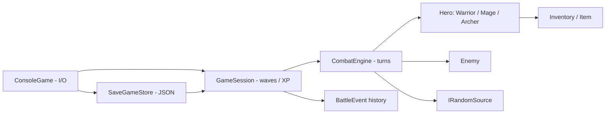

# ⚔️ PADO Arena

**A testable turn-based RPG engine for .NET 10** — three heroes, three arena battles, tactical combat, inventory, progression and JSON save/load. Built as a portfolio showcase for **C#, object-oriented design and Game Systems Programming**.

[](https://dotnet.microsoft.com/) [](https://github.com/PADOALEX/PADO-Arena/actions/workflows/ci.yml) [](LICENSE)

> No Unity, engine dependency, database, network service, or API key is required. Fully playable in your terminal.

## 🚀 Quick start

Requires the **.NET 10 SDK**.

```bash
git clone https://github.com/PADOALEX/PADO-Arena.git
cd PADO-Arena
dotnet restore PADO.Arena.sln
dotnet run --project src/Pado.Arena.Console
```

For repeatable enemy generation and random rolls:

```bash
dotnet run --project src/Pado.Arena.Console -- --seed 42
```

Build and run unit tests:

```bash
dotnet build PADO.Arena.sln -c Release
dotnet test PADO.Arena.sln -c Release
```

## 🧙 Playable heroes

| Hero | HP | MP | ATK | DEF | Dodge | Critical | Special |
| --- | ---: | ---: | ---: | ---: | ---: | ---: | --- |
| **Warrior** | 150 | 40 | 15 | 8 | 5% | 10% | Heavy Strike: 2× ATK (20 MP) |
| **Mage** | 80 | 100 | 25 | 3 | 10% | 5% | Fireball: ATK + 15, ignores armor (30 MP) |
| **Archer** | 100 | 60 | 18 | 5 | 20% | 25% | Double Shot: up to 2 independent hits (25 MP) |

Three randomized challengers: **Fast Goblin**, **Balanced Skeleton**, and **Strong Orc**. Each has its own HP, MP, attack, defense, evasion and crit chance. Enemies occasionally use **Brutal Attack** (25 MP).

## 🎮 Game loop

1. Start a new game or restore `arena-save.json`, then choose Warrior/Mage/Archer.
2. Fight **three sequential enemies**. Each turn choose Attack, Defend, Special or Item.
3. A valid player action is followed by one enemy action **only when the enemy survives**. Invalid choices and insufficient mana do **not** waste the turn.
4. On a kill, gain XP, recover up to 30 HP and 20 MP, and receive a Small Potion.
5. Level up every `level × 100 XP` (progress resets per level). Each level adds 15 Max HP, 10 Max MP, 2 ATK and 1 DEF.
6. Defeat all three to win, or lose if HP reaches zero. Save & Exit works between or during fights.

Sample terminal turn:

```text
===== BATTLE 1/3 | Fast Goblin =====
Hero Lv.1: 150/150 HP | 40/40 MP | ATK 15 DEF 8 | XP 0/100
Fast Goblin: 60/60 HP | 20/20 MP
1) Attack   2) Defend (+15 MP)   3) Heavy Strike (20 MP)   4) Item   5) Save & exit   6) Exit
Action: 1
  > Hero hits Fast Goblin for 13 damage.
  > Fast Goblin hits Hero for 4 damage.
```

## ⚖️ Combat rules and important edge cases

| Mechanic | Rule |
| --- | --- |
| Normal physical damage | `max(1, (baseAttack × (critical ? 2 : 1)) − targetDefense)` |
| Critical | Roll 0–99 below attacker's crit chance; doubles base damage **before armor** |
| Dodge | Roll 0–99 below target's dodge chance; prevents damage |
| Defend | One turn; incoming damage is halved **after armor**, rounded up (minimum 1), including enemy special attacks |
| Guard expiry | Always expires after the enemy's action, even if the defender dodges |
| Mana | Attack +5 MP, Defend +15 MP; enemy regenerates 5 MP before each action, all capped |
| Specials | Mana spent on a valid action, even when the attack is dodged; Fireball ignores defense and cannot crit |
| Archer | Each arrow rolls separately; second arrow is skipped if the first killed the enemy |
| Item | Use one inventory item as the turn action; it is consumed once and enemy may retaliate |
| HP / MP | Remain within `[0, Max]`; no healing from death, negative amounts rejected |
| End of combat | Killing an enemy immediately ends its turn; a defeated hero cannot act |

> **Save determinism:** Passing `--seed` reproduces a fresh uninterrupted run given the same inputs. Save files store all gameplay state, but **not the RNG's internal state**, so randomness after loading may diverge. Save validation rejects invalid states; saves are not cryptographically authenticated or tamper-proof.

## 🧱 Clean architecture

```text
PADO.Arena.sln
├── src/
│   ├── Pado.Arena.Core/           # No console I/O; persistence isolated by namespace
│   │   ├── Characters/           # Character, Hero subclasses, Enemy
│   │   ├── Combat/               # CombatEngine, events, commands, random abstraction
│   │   ├── Inventory/            # Item models
│   │   ├── Game/                 # GameSession, GameFactory, progression
│   │   └── Persistence/          # Versioned JSON DTO and storage
│   └── Pado.Arena.Console/       # CLI UI, input, output, battlelog
├── tests/Pado.Arena.Tests/       # xUnit deterministic unit tests
├── docs/                         # Architecture and evolution notes
└── .github/workflows/ci.yml      # Ubuntu CI: restore/build/test
```



**Separation of responsibilities:** `CombatEngine` takes a `PlayerCommand` and returns typed battle events. Core rules do not print, prompt, use global random state or write files. `GameSession` owns the three-wave lifecycle. `ConsoleGame` renders events and handles input. `SaveGameStore` serializes a validated, versioned snapshot. The random source is injected into both enemy generation and combat, so tests can control dodge, critical and AI decisions.

## 🧪 Tests & CI

[xUnit tests](tests/Pado.Arena.Tests/CombatTests.cs) cover normal damage, criticals, dodges, guard timing, insufficient mana, last-hit behavior, Archer double shot, Mage armor bypass, inventory consumption, progression, victory, defeat, deterministic seeds, JSON round-trip and invalid saves. GitHub Actions compiles the solution and executes tests on pushes and pull requests to `main`.

## 💾 Saves & battle logging

Choose **5) Save & exit** in a battle to write `arena-save.json` in the working directory. Choose **2) Load game** at startup to continue. The save is UTF-8 JSON, with schema version, wave index, class/stats, XP, inventory, enemy HP/MP and previous log lines. Invalid, oversized and incompatible files are rejected. Battle events are written to `battlelog.txt` at the end of play; both are ignored by Git.

## 🛠️ Tech stack

C# / .NET 10 · OOP / polymorphism · dependency injection (random source) · immutable combat events · JSON persistence (`System.Text.Json`) · xUnit · GitHub Actions

## 📜 Origin and design decisions

Refactored from the author's original `RpgArena.zip` educational console project. Preserved **Warrior, Mage, Archer, the three enemies, original base stats, potions, Heavy Strike, Fireball, Double Shot, Brutal Attack, inventory, 3 encounters and battle history**. Fixed guard state leakage, attack-after-death behavior, negative values and non-deterministic tests. Progression and save/load are added without introducing a database or a game engine.

See [Architecture & change log](docs/ARCHITECTURE.md) for more implementation detail and the migration rationale.

## License

MIT — see [LICENSE](LICENSE).