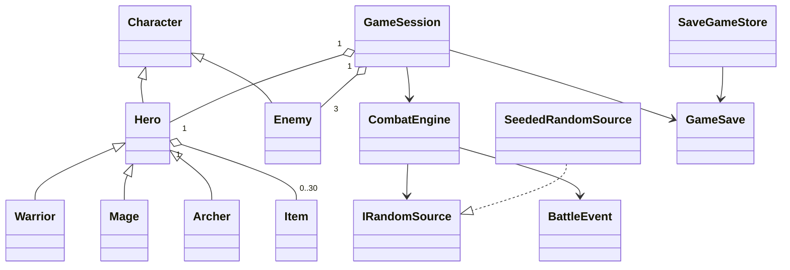
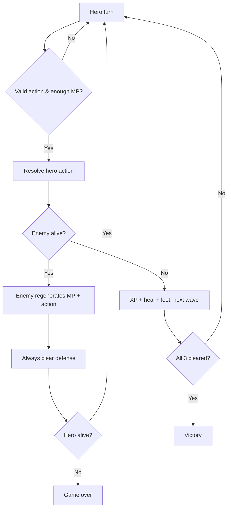

# Architecture & audit of the original RPG Arena

## Original source audit

| Source | Findings | Refactoring |
| --- | --- | --- |
| `Character.cs` | Static `Random` tightly couples hit math with nondeterminism; mutation methods accept negative values; `ReduceMana` silently clamps even for unaffordable abilities | Pure stat object with defensive validation, explicit `TrySpendMana`, injectable `IRandomSource` in the combat layer |
| `Hero.cs` | `IsDefending` cleared only inside `TakeDamage`; dodging while defending carries guard into later turns; attacks and text mixed inside subclasses; second arrow can strike a dead target | Per-turn guard cleanup in `CombatEngine`, declarative special skills in polymorphic hero subclasses, stop multi-hit on death |
| `Enemy.cs` | Random selection and battle behavior scattered; Brutal Attack logic duplicated with hero specials | Enemy presets and engine-controlled AI with seeded randomness |
| `Item.cs` | Mutable constructor values without validation | Validated immutable record, inventory lifetime managed by `Hero` |
| `Game.cs` | ~200 lines handling console I/O, randomness, hero choice, encounters, victory, file logs, items and enemy AI | `GameSession`, `GameFactory`, `CombatEngine`, `ConsoleGame`, `SaveGameStore` |
| `Program.cs` | Single `Main()` simply launches `Game` | CLI accepts `--seed`, `--help` and exits cleanly on EOF |

## UML-style relationships

## Turn state machine

## Explicit rules

- Critical hit is applied before armor; if dodged there is no critical roll.
- A defending hero halves post-armor damage, rounded up, and guard expires after the enemy action, including when dodged.
- Valid hero actions always consume the turn. Using an item does not suppress enemy retaliation.
- MP costs are verified before the turn begins; invalid and unaffordable actions consume no MP or turn.
- The enemy may choose Brutal Attack only when sufficient MP remains after its 5-MP regeneration.
- Kill rewards are assigned exactly once when the current enemy reaches 0 HP.
- Both combatants' HP/MP are clamped; cannot revive from 0 HP by healing.
- Progression is bounded to level 50. The experience threshold for the next level is `current level * 100`.
- Saves cover the current battle's HP/MP, inventory, progression and event history. Save schema version 1 does not preserve PRNG internal state.

## Follow-up ideas (not needed for scope)

- Content-driven balance data for enemies and abilities.
- More complex status effects with explicit lifetime rules.
- Capture/replay of PRNG state for bit-exact resumed battles.
- A console smoke test in CI that runs a deterministic scripted match.